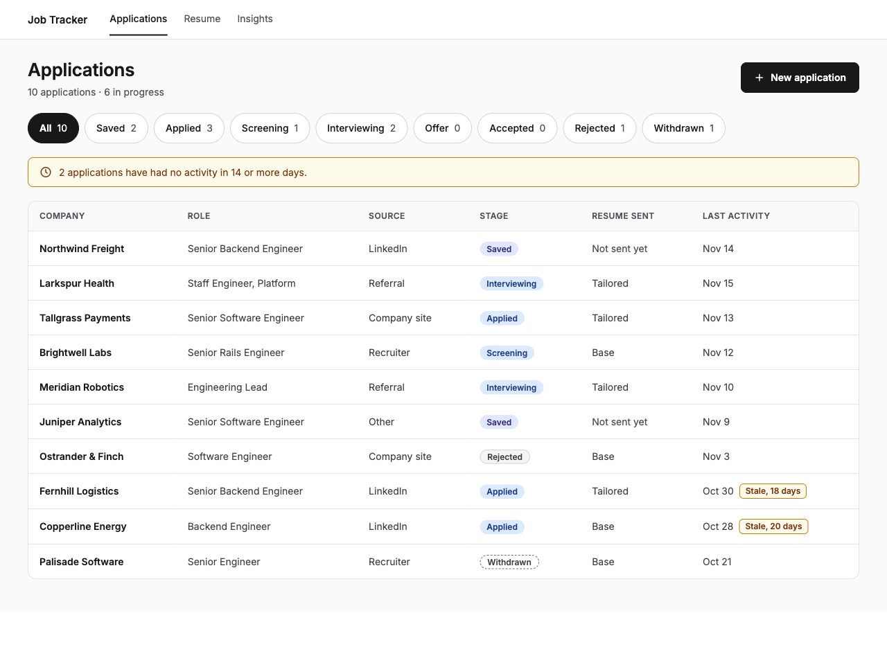
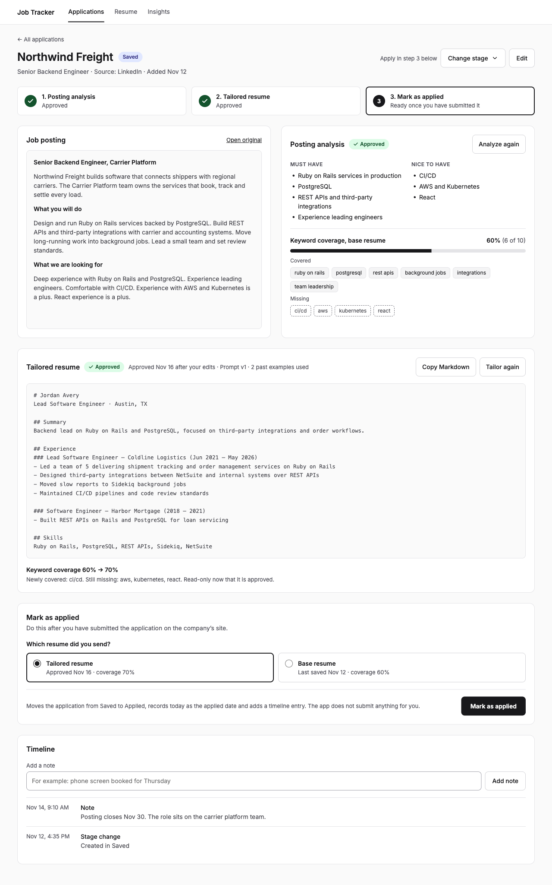

# Job Application Tracker

Tracks job applications through a hiring pipeline, analyzes postings, and tailors a base resume with AI. A person approves every AI output.

- **Track.** One list of applications, an enforced stage pipeline (Saved, Applied, Screening, Interviewing, Offer, Accepted, Rejected, Withdrawn) and an append-only timeline for each.
- **Analyze.** The AI reads a pasted job posting and returns requirements and keywords. Code measures how many keywords the base resume already covers.
- **Tailor.** The AI rewrites the base resume for one posting. A deterministic guardrail flags any employer, title, date, number, skill or keyword that the base resume does not contain. The user edits the draft, then approves or rejects it.
- **Measure.** An Insights page shows the funnel, time in stage, response rates and how each prompt version performs, all calculated from the event logs.

This is a single-user app with no authentication.

Related links:
- [docs/AI_WORKFLOW.md](docs/AI_WORKFLOW.md): how it was built with Claude Code, thoughts about agentic workflow
- [docs/project-overview.md](docs/project-overview.md): about the project
- [docs/architecture.md](docs/architecture.md): architecture

Some screenshots:





## Prerequisites

- Python 3.12 (uv installs it if missing)
- [uv](https://docs.astral.sh/uv/)
- Node.js
- PostgreSQL 16, running locally

## Commands

```bash
make setup   # create the dev and test databases, run migrations, install dependencies
make dev     # start the API (port 8000) and the web app (port 5173)
make seed    # fill an empty dev database with about 40 fictional applications (make seed ARGS=--reset wipes it first)
make test    # backend and frontend tests
make lint    # backend and frontend lint
make eval    # run the prompt eval against the real model (costs money, run by hand)
```

`make setup` copies `.env.example` to `.env` if there is no `.env`. Put `ANTHROPIC_API_KEY` and `ANTHROPIC_MODEL` there; `.env` is not committed. Analyzing and tailoring need them. Everything else, including `make seed` and `make test`, works without them, and no test makes a network call.

The web app proxies `/api/*` to the API and strips the `/api` prefix. API docs are at <http://localhost:8000/docs>.

To try the app, follow [docs/demo.md](docs/demo.md).

## Out of scope

- Authentication or multiple users
- Scraping postings from a URL (paste the text)
- Uploading or parsing resume PDFs (Markdown only)
- Email or calendar integration
- Payments
- Docker and deployment
- External observability stacks (Prometheus, Grafana, Datadog)
- Vector search
- Resume export
- Deleting applications, and undoing a terminal stage (a mistake is corrected with a note)
- Re-running an analysis automatically when the posting text is edited
