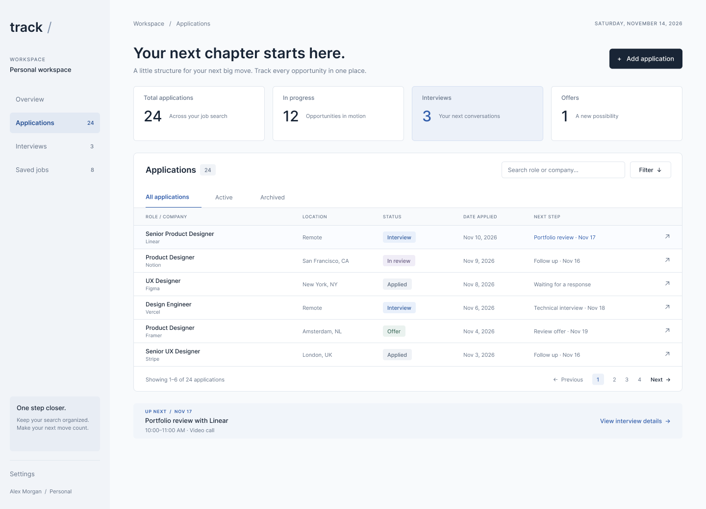
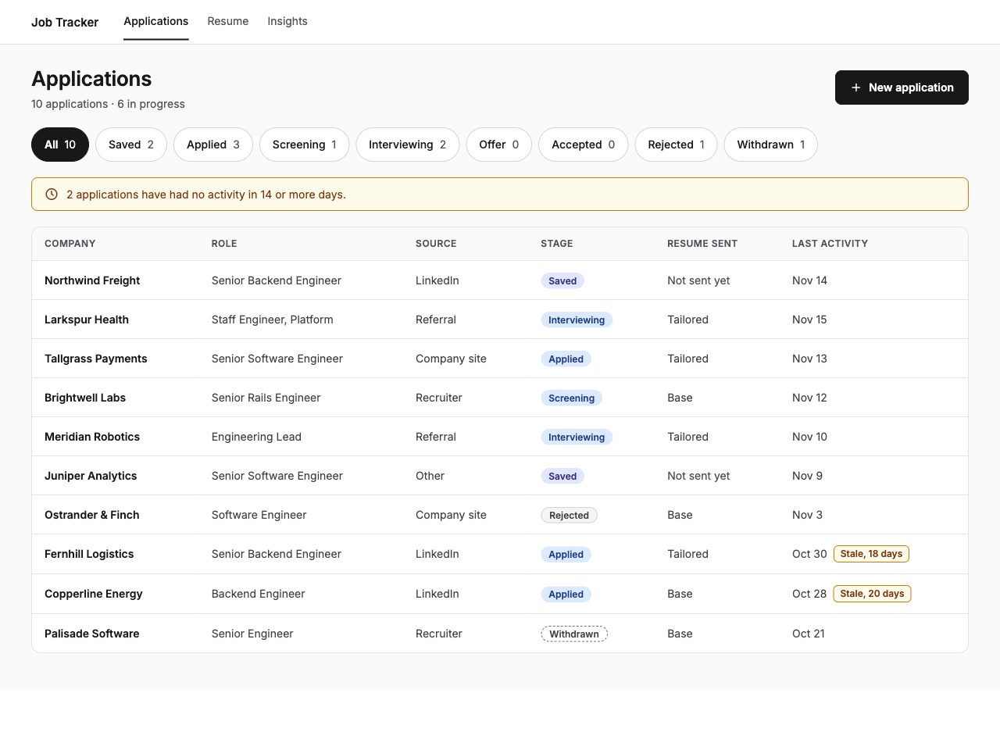

# AI Workflow

How this app was built from a written specification using Claude Code.

## Approach

### Deciding on a project

First, I decided what kind of project I want to work on. I want it to involve AI usage. I came up with 4:
1. Vim editor practice trainer: generates spaced-repetition drills for Vim commands and tracks my progress, and AI generates practice exercises from a topic.
2. Running training log: log my runs, see pace trends toward my mile goal and get an AI-suggested weekly plan that I accept or adjust.
3. Grocery and meal planner: use Kroger supermarket's API to create reusable meal plans and generate a grocery list. AI suggests the products to buy that week.
4. Job application tracker: paste a job posting, AI pulls out the requirements, matches them against my resume, and drafts talking points for you to edit. It tracks the pipeline from applied to screen to offer.

I crossed out the first 2 because (1) is hard to measure (I have little room to improve) and (2) because mile goal will require a lot of real life data, which I currently don't have available. When I signed up with Kroger developer portal, I noticed the website was slow, so I question the reliability of the API. I decided to go with (4) because it involves parsing natural language and it's directly related to applied AI, which Compsci LLC is also building ([applied-ai-engineering](https://www.compscillc.com/services/applied-ai-engineering/))

I used Claude on this step, but only minimally, mainly to challenge my choice of the job application tracker. The decision of which app to work on is a judgment call, not a technical call, so the choice is mine. 

### Claude as a brainstorming partner

Once I decided which project to work on, before I opened Claude, I knew the rough shape of the project: a full-stack React (front-end) + Python (backend) + PostgreSQL (DB), where I feed an LLM my resume and a job description (JD). I knew I wanted to use RAG to improve the results. There were still missing details, so I used Claude as a brainstorming partner. 

Claude makes a great brainstorming partner, but needed to be used carefully. LLMs tend to agree with whatever I propose. If I ask "Is X a good idea?", it will probably agree with me. First, I gave it constraints to limit the options along with the goal: A job tracker app, with a prompt + JD + resume on each LLM step, including RAG operation. The goal is a tailored resume. Some constraints are: outputs are stored in the DB so they can be looked up later, and it would have deterministic and nondeterministic parts. You have 4 days, single user, use Python + React + PostgreSQL stack, no invented facts, a human approval is at the end of every LLM output. Second, I asked it to argue against each suggestion, with at least one weakness and one alternative. 

One of the core operations looks like this:

```
TailoredResume = LLM(prompts + JD + BaseResume + [TailoredResume1, TailoredResume2, ...])
```

The `+` means that everything is combined into one prompt. `prompts` is the instruction template. `JD` is the job description, and `BaseResume` is my master resume. The bracketed list is the RAG step - it looks up to 3 past approved tailored resumes (if they exist) and includes them as examples. This lookup is deterministic. The LLM call that uses the lookup's results is the non-deterministic part. Deterministic code is put around the LLM call.

Due to the time constraint, RAG is limited. It only retrieves past approved tailored resumes as style examples. The base resume is the only source of facts. I think ideally the app would ask the user for a list of STAR stories and accomplishments from previous workplaces. When it gets a JD, it would use RAG to find the stories most relevant to the JD's requirements and give them to the LLM as extra facts. That way the tailored resume can include real accomplishments the base resume left out, not just reword what's already there. For example, if I did Kubernetes at a previous employer, my resume doesn't mention it, and the JD lists it, the tailored resume could add Kubernetes. The guardrail would then check the draft against the base resume plus the stories.

### Frontend

Next, I used Claude to scope the frontend: the core features, the pages, and how to slice the work. Claude suggested more features than we ended up with. I pushed back on a few: a separate dashboard page beyond Insights, PDF export, interview prep and others. They weren't essential to the app's core, and they can come later.

With the essential pages known, I had two options: build the UI from scratch, or use an existing library. The app's core feature is in the backend and the AI integration, so I didn't want to spend too much time on design. I chose Tailwind and shadcn/ui, to keep the code small.

I used Figma and Claude artifacts to make a few UI mockups and asked for changes (for example, the "Mark as applied" section was originally a popup, but I went against it because it wasn't consistent with the Job Posting and Tailored Resume steps).

Here is one alternative mockup before I decided on the other one:



I decided on this:



Once I agreed on a mockup for each page, I used [v0.app](https://v0.app/) to prototype them quickly in React. I asked v0 to keep the dummy data in one object so seeded database data can replace it later. I saved the final screenshots in `docs/screenshots/`, named by page, and the prototype code in `docs/reference/v0-prototype/`. The prototype is reference-only. Claude used it for layout and component choices. None of it is imported into the app.

On this step, I gave more control to the LLM (Claude and Figma), although ultimately I made the final call. But if I could do it over, I think it would be better to find design references (screenshots), tell it what to take from each one ("from reference1: the table, from reference2: the color palette and night mode switch, from referenceN: ..."), add some constraints, and iterate until it's right.

### Feature mapping

Having mockups helped me visualize the app's behavior. Now it's time to turn the rough feature list into something concrete.

During this phase, Claude was my Product Manager / planning partner. I gave it as much context as I could (including the goal, the core features, a rough list of features, the mockups and the constraints). I described the core idea and Claude helped to tighten it. In the end, I would need to approve it. I also stated what success looks like: a tailored resume, plus a way to measure how effective previous tailored resumes were (telemetry).

Our discussion also showed us a new core feature: state management for Applications. How do we know whether tailoring works? One way is to measure how often I edit a draft. Another is to measure how many tailored resumes lead to progress in the pipeline. This needs a record of where each application is and how it got there. Application processing needs to be tracked. Application stages and the timeline became part of the core (in addition to LLM tailoring).

I asked Claude to stress-test some of my ideas, some examples:
- "If we allow the generated resumes to be updatable, what could go wrong?" It could corrupt observability, so each updated resume creates a new row.
- "Should we force the user to go through steps 1, 2, and 3 sequentially?" No. The user can skip straight to step 3 and submit the base resume directly.

Once we agreed, Claude helped to write these documents:
- `project-overview.md`: a technical PRD. It covers what the app does, the deterministic vs. non-deterministic split, the stack with the required libraries and versions (Claude must ask before installing anything not listed), the features in build order, the domain rules (stages, transitions, AI rules), the data model and the UI guidelines.
- `architecture.md`: the system design. It covers the layers and which way dependencies point (`api/ -> services/ -> repositories/ -> models/`), which parts of the system are deterministic and which are LLM calls, how an AI call is shaped and logged, and more.
- Feature specs (`docs/features/NN-*-spec.md`): one per feature. Each feature is a thin vertical slice through the stack (database, API, UI) that leaves the app still working. A spec states the main goal, some of the requirements, and testable acceptance criteria. If the feature has a UI, the spec also points to a screenshot in `docs/screenshots/` as a reference for Claude.

Some rules:
- Each slice leaves the app in a working state.
- Build infrastructure first. The scaffold comes first, then CRUD and the state machine, then the AI wrapper.
- Deterministic rules come before AI.
- Telemetry and metrics come last (they need data to measure!)
- Follow dependencies. Don't start resume tailoring before posting analysis exists, because tailoring depends on it.

Each spec is small enough to plan, build, test and review in one Claude session. Each has testable acceptance criteria, so `/feature test` and `/feature review` have something concrete to check.

All of these documents live in `docs/` and are linked from `CLAUDE.md`. The custom skills and sub-agents live in `.claude/`. Once the features were mapped out, we could start implementing them.

## Feature Implementation

Once the docs are created, I moved to feature implementation step. 

### CLAUDE.md
 
First, I asked Claude to build CLAUDE.md. Because CLAUDE.md is read on every session, I put the important things there. At this point, LLM frontier models are advanced enough that I don't need to tell them, "Keep things DRY." They are advanced enough to know this without explicitly needing to be told. I think CLAUDE.md should contain things related specifically to the current project. I also try to keep it small because having CLAUDE.md too long would degrade quality ([Claude documentation](https://code.claude.com/docs/en/memory#write-effective-instructions) suggests keeping it < 200 LOC).

In this case, I gave it a brief, high-level overview of what the project is, and links to the documentation, like project overview, architecture, feature specs, screenshots and prototype directories, and current file (the current file is a file for what is being worked on right now and to hold the status and decisions for the in-progress feature). I also gave it commands needed to run the app like `make dev`, `make test`, `make seed` (so Claude doesn't have to spend tokens looking up how to do something each time). I also gave it an instruction on how to run the feature implementation workflow so each feature implementation step is consistent. Although we have an architecture.md file, I gave it a brief set of high-level architectural rules. I also gave it important coding implementation rules (Rules that must never be broken, AI rules, UI rules, dependencies and migrations) to keep feature implementation consistent. Finally, I gave it definition of done so each session ends at the same place.

### The `/feature` skill

I asked Claude to build the `/feature` skill for the feature-spec workflow to implement each of the predefined specs.

It has a few actions:
- `/feature load N`: loads the spec for feature N
- `/feature plan`: Claude lays down the plan (files, migrations, tests, new dependencies, assumptions). Discussion may happen. Requires my approval before moving forward
- `/feature start`: Claude implements the feature (tests first before implementation)
- `/feature test`: unit tests and lint
- `/feature review`: returns with a list of grouped issues by severity (blocker / major / minor / nits). Fixes require my approval
- `/feature explain`: summarizes the changes and covers per-file explanations with request flow
- `/feature complete`: runs `make test` and `make lint`, updates `architecture.md` (if needed) and `current.md`, commits, and pushes the feature branch.

Using this flow is simple: I'd run these actions in order of each feature. So if I'm implementing feature 1, I'd do: `/feature load 1` -> `/feature plan` -> `/feature start` -> `/feature test` -> `/feature review` (in a fresh context; I also added an `agent` option) -> `/feature explain` -> `/feature complete`.

I think this flow works because:
- A lot of the work was already completed during pre-planning, and right now we implement our specs.
- Plans may change (there's only so much pre-planning can do), so another round of discussion may happen before implementation
- There were 2 checkpoints where I had Claude require my approval to check its work. The first is `plan`, before starting implementation and the second is after `review`. I put human gates before AI starts coding and before it applies review fixes.

Halfway, I added a subagent, `feature-reviewer-agent.md` that runs `/feature review` using a subagent so I wouldn't have to start a new session each time. I can invoke it by running `/feature review agent`.

A lesson that I learned building this: I noticed that towards the end of the day, I started losing focus and would start rubber stamping `/feature plan`. This would happen when the plan was too long and my mind was getting tired. However, this didn't excuse my lack of due diligence.

So I changed `/feature plan`. Instead of waiting for me to say "approved", Claude now makes me recap the plan in my own words first. The recap has to be correct and say at least two concrete things, such as what gets built where or what the migration adds. Claude checks each claim against the plan and the code, and quotes any mistake with file and line proof. I only get to approve after a correct recap. 

### Other skills and agents created

Besides `/feature`, I added a few other skills and agents 
- `/tour (main, frontend, backend, paths, states, tests, since)`: explains the code the agent wrote, one slice at a time (whole app / frontend / backend / user flows / state machine / tests / what changed since a commit)
- `/wait-what`: re-explains Claude's last message 
- `/railsplain`: explains to me a codebase in Rails terms
- `/grill-me`: grills me on a plan, decision, or idea.

Agents created:
- `ui-reviewer-agent`: for running Playwright to test UI
- `feature-reviewer-agent`: for running feature review (see above)

Also, all four skills plus feature have `disable-model-invocation: true` so Claude won't run them on its own.

When building with AI, I find that skills are like helper methods. They are on a per-case basis. When I find myself doing the same thing 2-3 times, I'd ask Claude to create a skill for that task.

## Reflections

### When to trust AI's work?

When building an application agentically, it comes down to: how much do I trust its work? How much supervision does it need? How much does a person need to understand the code AI generated?

I recently ran across this article [How the Claude Code team does code review](https://claude.dev/blog/solving-code-review-at-anthropic/), which was insightful. It talked about how Claude wrote about 90% of Claude Code's own code, and the main discussion centered around how they did code review. I think this is relevant to building an app agentically. When building agentically, one question comes up: "When is AI review sufficient?"

In the article, it talked about how there are 3 different code tiers / classifications.
- Tier 1 (low risk): It's safe to trust AI code review for internal-only features, additive changes (as long as they're behind a feature flag), docs, and other low risk changes. These don't even need a human approval once automated checks pass.
- Tier 2 (medium risk): one human approval, for most changes that aren't mentioned above.
- Tier 3 (high risk): two human approvals. These are the highest risk changes. The article didn't give any examples, but I'd assume changes involving CIs, release workflows, billing / payments, auth, and anything with a high blast radius.

That made me think, maybe we need to vary approval steps based on the level of risks. We could have a classifier system that reads the change and picks the tier (the classifier itself is automated, and it will probably be either an agent or some deterministic code).

Similar concept can probably go into feature implementation, not just code review. How much a human should be in the loop for a feature implementation should be based on the risk. My loop puts a human after `/feature plan`. The classifier could read the plan and assign the risk level. If it's of a higher risk, then it would force a human (or two) into the loop to review the plan before letting the agent write the code, or even require a human to be in the code implementation loop, too. Skipping the human is only as safe as our ability to undo what the agent builds.

