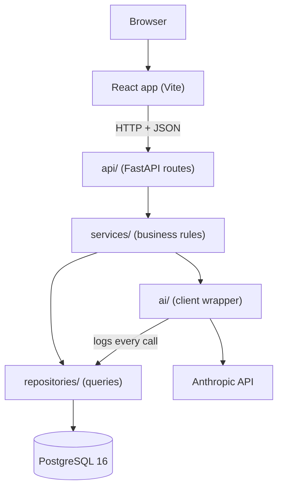
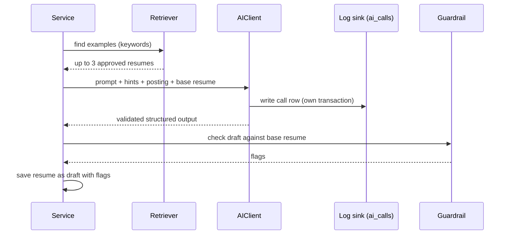

# Architecture

> Update this file whenever the structure changes so it always describes the code as built.

## System overview

Three tiers: 

- a React single-page app
- a FastAPI backend
- PostgreSQL

The backend is the only part that talks to the database or the LLM.

## Backend layers

Request flow: `api/ -> services/ -> repositories/ -> models/`.

| Layer | Responsibility | Must not |
| --- | --- | --- |
| `api/` | HTTP only: parse and validate input, call one service, return a schema | Query the database or hold business rules |
| `schemas/` | Pydantic models for requests and responses | Contain logic |
| `services/` | All business rules: transitions, guards, coverage, guardrail, review, metrics | Import FastAPI or write SQL |
| `repositories/` | All database queries | Make decisions |
| `models/` | SQLAlchemy table definitions | Contain logic |
| `ai/` | Anthropic client wrapper, prompt templates, output schemas | Be called except through the `AIClient` interface |
| `core/` | Config from environment variables, DB session, logging, middleware, the clock (`clock.py`, injected into services so tests control "now") | Know about the domain |

## Deterministic and non-deterministic parts

| Step | Kind | Module |
| --- | --- | --- |
| Stage transitions and guards | Deterministic | `services/transitions.py`, `services/applications.py` |
| Timeline history | Deterministic | `repositories/timeline.py` |
| Extract requirements and keywords | Non-deterministic (LLM) | `services/analysis.py` via `ai/` |
| Keyword coverage | Deterministic | `services/coverage.py` |
| Retrieve past examples | Deterministic | `services/retrieval.py` |
| Write a tailored resume | Non-deterministic (LLM) | `services/tailoring.py` via `ai/` |
| Render structured output to Markdown | Deterministic | `services/rendering.py` |
| Guardrail check | Deterministic | `services/guardrail.py` |
| Approve or reject | Human | `services/review.py` records the decision; `services/resume_review.py` applies it to a tailored resume |
| Edit a draft, outcome, edit ratio, which resume is displayed | Deterministic | `services/resume_review.py` |
| Workflow step status | Deterministic | `services/submission.py` |
| Stale rule | Deterministic | `services/staleness.py` |
| Metrics | Deterministic | `services/metrics.py` |

Only two steps call the LLM. Each is followed by deterministic checks and a human decision.

Each LLM step is split in two. A pure function in `services/generation.py` (`analyze()` and `tailor()`) calls the `AIClient` and returns validated output, and it touches no database. The service around it (`services/analysis.py`, `services/tailoring.py`) gathers the inputs, calls the pure function and saves the result. The eval calls the pure functions directly with an in-memory log sink.

## Keyword coverage

Plain code, no AI, calculated on every request and never stored. `services/coverage.py` has two parts:

- `keyword_coverage(keywords, resume_text)`: a pure function returning `Coverage(covered, missing, ratio)`. It casefolds both texts and collapses every whitespace run to one space (those are the only normalizations: no hyphen, slash or Markdown handling, no stemming). Each distinct keyword is then escaped and matched as `(?<!\w)keyword(?!\w)`, so `java` is not found in `javascript` and terms like `c++` and `.net` work, which `\b` cannot do. Blank keywords are dropped, repeats count once, and the ratio is 0.0 when there are no keywords. The review flow and the eval call it directly.
- `CoverageService.for_application(application_id, resume_id=None)`: picks the analysis (the latest approved, else the latest draft, never a rejected one) and the resume (the base resume, or `resume_id`, which must be the base resume or one of this application's). With a `resume_id` it also returns the base resume's coverage, `newly_covered` (covered now, not in the base) and `still_missing` (missing from both).

`GET /applications/{id}/coverage` (`api/coverage.py`) answers 404 for an unknown application, no usable analysis, no base resume, or a `resume_id` that is not allowed. `base`, `newly_covered` and `still_missing` are left out of the response when no `resume_id` is given. The Posting analysis card shows the result (`CoverageBlock`); when there is no base resume it links to the Resume page instead. The card shows the newest analysis while coverage follows the rule above, so after Analyze again on an approved analysis they can describe different analyses.

## Reviewing a tailored resume

`services/resume_review.py` holds the review of a tailored resume. Nothing here creates a row: a new resume comes only from a tailoring call, and editing, approving and rejecting change the row in place.

- `TailoredReviewService.save_edits()` replaces `content_markdown` (and `updated_at`) of a draft, exactly as given. `draft_markdown` and `guardrail_flags` are never written. `approve()` and `reject()` go through `review.apply_decision()`, the only code that sets a status. Each call locks the row (`ResumeRepository.get_tailored_for_update()`), which returns only tailored resumes, so the base resume and its snapshots answer 404. A resume that is no longer a draft answers 409.
- `PATCH /resumes/{id}` takes `ResumeWrite` (the text only, never blank, no other field) and returns the resume with its current flags and the coverage of the new text (`TailoredResumeEditRead`). `POST /resumes/{id}/approve` and `/reject` return the resume. Approving with unsaved edits is two calls from the frontend: PATCH, then approve.
- `present()` turns the application's tailored resumes (newest first) into `TailoredDraft`s: the current flags, the `outcome` and `displayed`. `GET /applications/{id}/tailored-resumes` and every response above use it, so they agree.
  - `derive_outcome()`: pending, superseded, approved, edited then approved or rejected. A draft is superseded when any newer tailored resume exists for the application. A decided resume is never superseded.
  - `displayed_resume()`: the newest resume if it is a draft awaiting review, else the latest approved, else the latest rejected. The frontend renders the one marked `displayed`.
  - `edit_ratio()`: `1 − SequenceMatcher(None, draft, content, autojunk=False).ratio()`. Built and tested, but not exposed until the metrics (feature 14).
- Outcome, edit ratio and `displayed` are calculated on request and never stored.

## Trust chain for AI output

An LLM result passes through three layers before it is used:

1. **Schema.** Structured outputs constrain the response to a JSON schema, and Pydantic validates it. This guarantees shape, not truth.
2. **Guardrail.** Plain code compares the draft's employers, titles, dates, numbers, skills and posting keywords with the base resume and flags anything not found, matching whole tokens only. This checks facts that code can match exactly. The flags as generated are stored for metrics. The flags the user sees are recalculated from the current text, so editing updates them.
3. **Human.** Every analysis and resume is saved as `draft`. Only a user action sets `approved` or `rejected`.

Separately, the eval script measures how often a prompt version produces flags, so prompt changes are judged on numbers.

## State and guards

Application stage is a state machine defined as data.

- `services/transitions.py` holds the allowed transitions and a guard table keyed by action. An action is a stage transition (for example Saved → Applied) or another gated step (Start tailoring). A guard is a function `(context) -> None | GuardFailure`, where `context` carries the application, its related records and any extra input, such as the chosen resume.
- `ApplicationService.change_stage()` is the only code path that writes `applications.stage`. It locks the application row (`ApplicationRepository.get_for_update()`), validates the transition, runs the guards, runs the transition's effect if it has one, updates the stage and inserts a timeline event in one transaction. Any failure rolls back, which also releases the lock. The service takes a clock, so tests control "now". Two documented exceptions: creating an application (the column default is `saved`, and the service writes the initial event) and the seed script.
- Guards read the state of other entities. This is how separate lifecycles interlock:

| Action | Guard |
| --- | --- |
| Start tailoring | The application has an approved posting analysis, and a base resume exists. Two guards in `GUARDS["start_tailoring"]` (`require_approved_analysis`, then `require_base_resume`), each returning its own reason |
| Saved → Applied | The request chooses a resume: the base resume, or an approved tailored resume for this application. Choosing the base resume saves a snapshot of it, and the snapshot becomes the submitted resume |

`POST /applications/{id}/apply` is the only endpoint that performs Saved → Applied. It calls `ApplicationService.apply()`, which calls `change_stage()` with the choice and resume id in `context`; the snapshot is created in the same transaction (see Marking an application as applied). The generic stage endpoint rejects that transition with 409, because it passes no choice and the first guard refuses.

Analyses and resumes have their own small lifecycle: `draft → approved` or `draft → rejected`. A draft with a newer draft for the same application and feature is shown as `superseded` (derived, never stored and never auto-rejected).

The detail page shows three workflow steps: posting analysis, tailored resume, mark as applied. Their status (locked, available, current, done, skipped) is computed from the records by a pure function and returned by the API. It is never stored. Rules, checked in this order for each step, with "left Saved" meaning the stage is no longer Saved:

| Step | done | skipped | locked | current | otherwise |
| --- | --- | --- | --- | --- | --- |
| 1 Posting analysis | an approved analysis exists | left Saved without one | never | stage is Saved and none is approved | never |
| 2 Tailored resume | an approved tailored resume exists | left Saved without one | no approved analysis | an approved analysis exists and no approved tailored resume | never |
| 3 Mark as applied | left Saved with a submitted resume | left Saved without one (withdrawn) | no base resume exists | stage is Saved and an approved tailored resume exists | available |

At most one step is current. An application withdrawn from Saved shows no applied date and is never shown as applied.

## Data principles

- **Append-only logs.** `timeline_events` and `ai_calls` are never updated or deleted. The repositories expose no update or delete for them, and database triggers reject both. Triggers also reject any change to `resumes.draft_markdown`. `TRUNCATE` is not blocked, so `seed --reset` and test cleanup still work.
- **Current state is a projection.** `applications.stage` is the latest state; the timeline is the history. Both are written together in `change_stage()`.
- **Derived values are never stored.** Keyword coverage, AI outcome, edit ratio, guardrail flag count, current guardrail flags and every metric are calculated on request from stored rows. `guardrail_flags` itself is the stored snapshot of the flags as generated.
- **Original drafts are preserved.** `resumes.draft_markdown` never changes after generation, so the amount of user editing can be measured against `content_markdown`.
- **What was sent is preserved.** Marking an application as applied with the base resume stores an immutable snapshot of it. Editing the base resume later never changes the record of what was sent.
- **Snapshots are not tailored resumes.** A snapshot is a `resumes` row with `application_id` set and `ai_call_id` null. A tailored resume has both set. The resume repository selects tailored resumes with that condition (`list_tailored_for_application()`, `get_tailored_for_update()`, `tailored_statuses_by_application()`), and retrieval and metrics must do the same.

## AI call path

- Prompts are versioned modules in `ai/prompts/`. Each exposes a `VERSION` and a `render()` function that returns a `RenderedPrompt` (`PromptModule` is the Protocol).
- Modules, as built:
  - `ai/types.py`: the `AIClient` and `LogSink` Protocols, `AICallRecord`, `AIResult`, and the errors (`AIAPIError`, `AIRefusalError`, `AITruncatedError`, `AIValidationError`, each carrying the `ai_call_id`; `AIConfigurationError` is separate because no call was made).
  - `ai/client.py`: `AnthropicAIClient.generate()`, the only code that calls Anthropic. It uses `messages.create` with a JSON schema from the Pydantic model, checks the stop reason, then validates the text itself. It never sets a temperature.
  - `ai/sinks.py`: `DatabaseLogSink` (own session and commit, through `repositories/ai_calls.py`) and `InMemoryLogSink`.
  - `ai/cost.py`: `estimate_cost()` over the `MODEL_PRICES` table in `core/config.py`.
  - `api/ai.py`: `get_ai_client()`, the FastAPI provider that tests override with `FakeAIClient` (`tests/fakes.py`).
  - `models/ai_call.py` and `repositories/ai_calls.py`: the table, and a repository with `add` and `get` only.
  - `scripts/ai_smoke.py`: a hand-run check of the real API against the test stub. It is not part of `make test`.
  - `ai/schemas.py`: the output models the LLM must return (`PostingAnalysisOutput`, `Requirement`, `RequirementCategory`). They carry no limits such as `maxItems`; code enforces those after parsing.
  - `ai/prompts/posting_analysis.py`: prompt `posting_analysis` v1. It wraps the posting in `<posting>` tags, tells the model to treat it as data and neutralises any `</posting>` inside the text.
  - `ai/prompts/tailor_resume.py`: prompt `tailor_resume` v1. Its user text wraps `<base_resume>`, `<posting>`, `<keywords>` and `<examples>`, and the examples block is always there, empty until feature 12. `ai/schemas.py` also holds `TailoredResume` and `Experience`.
  - `services/generation.py`: `analyze()`, the pure function that makes the call and normalises the result, and `tailor()`, which makes one call and returns the validated `TailoredResume`.
- The wrapper writes one row per call to a log sink, including failures (API error, refusal, truncated output, validation error). The app's sink writes `ai_calls` and commits in its own transaction, so the row survives a rollback in the caller. The eval passes an in-memory sink.
- `AIClient` returns the validated output and the `ai_call_id`, so artifacts can store the foreign key.
- The model name and API key come from environment variables and never reach the frontend.
- Tests inject a `FakeAIClient` that writes through the same log sink, so rows and foreign keys behave as in production. No test makes a network call. Because the log commits separately, tests clean up by truncating tables instead of rolling back.
- Starting an analysis or a tailoring takes a Postgres advisory lock per application and feature (`repositories/locks.py`). It is a transaction-level, non-blocking lock (`pg_try_advisory_xact_lock`) held in the request's transaction across the AI call, so a second request gets 409 at once and a crash or rollback releases it. The cost is one database connection held while the call runs. The buttons are also disabled while a call is in flight.

## Retrieval

`services/retrieval.py` defines an `ExampleRetriever` interface. The MVP implementation uses PostgreSQL full-text search over `applications.posting_tsv`, queried with the approved analysis keywords joined by OR (multi-word keywords quoted) and ranked by `ts_rank`. A vector-search implementation can replace it without changing the tailoring service.

## Base resume

One editable Markdown document, stored as the `resumes` row with no application (`application_id` null). A unique partial index (`resumes_one_base_idx`) lets the database allow only one. `GET /resume` returns it or 404. `PUT /resume` creates or replaces it in place and always leaves it `approved`: `ResumeService.save_base()` sets the status and `updated_at` (from the injected clock), and the request schema carries only the text. A save that loses a race to a parallel first save replaces the row the other one created. Blank text is rejected. Replacing the text never changes what an application already sent, because applying with the base resume stores a snapshot (feature 11).

## Posting analysis

`POST /applications/{id}/analysis` makes one AI call and saves a `draft` row in `posting_analyses`. `GET /applications/{id}/analysis` returns the analysis to display (or `null`). `POST /analyses/{id}/approve` and `/reject` are the only things that change a status.

| Module | Role |
| --- | --- |
| `api/analysis.py` | The four routes. Only `POST .../analysis` depends on `get_ai_client`. Maps `AnalysisInProgress` to 409, `AIError` to a generic 502 and a missing application or analysis to 404. |
| `main.py` | An exception handler turns `AIConfigurationError` into 503 "AI is not configured." |
| `services/analysis.py` | `PostingAnalysisService`: `run()` (lock, `analyze()`, save, commit; rolls back on any failure), `get_for_display()` and `approve()` / `reject()`. |
| `services/review.py` | The review lifecycle as data (`REVIEW_TRANSITIONS`: draft to approved or rejected) and `apply_decision()`, the only code that assigns an analysis status. Feature 10 reuses it for resumes. |
| `repositories/posting_analyses.py` | Queries for the table. It has no delete. |
| `repositories/locks.py` | The advisory lock. |
| `models/posting_analysis.py` | The table. `prompt_version` is read from the linked `ai_calls` row, not stored. |

- Every Analyze inserts a new row and old rows are kept, because the AI metrics are calculated from them. An older draft is never auto-rejected.
- The card shows the newest analysis, except that a rejected one never hides an older approved one. The rule lives in `get_for_display()`, and the frontend only renders what the API returns.
- Approve and reject are allowed only from `draft`; anything else is a 409.

## Tailored resume

`POST /applications/{id}/tailored-resumes` makes one AI call and saves a `draft` row in `resumes`. `GET /applications/{id}/tailored-resumes` lists them, newest first.

| Module | Role |
| --- | --- |
| `api/tailored_resumes.py` | The two routes. Only the POST depends on `get_ai_client`. Maps `TailoringBlocked` to 409 with the guard's reason, `TailoringInProgress` to 409, `AIError` to a generic 502 and a missing application to 404. |
| `services/tailoring.py` | `TailoredResumeService`: `run()` (load the application, run the `start_tailoring` guards, take the lock, `tailor()`, render, `check()`, save with the flags, commit; rolls back on any failure) and `list_for_application()`. Both return `TailoredDraft(resume, flags)`, where `flags` are the current flags. |
| `services/generation.py` | `tailor()`, the pure function that makes the call. It touches no database. |
| `services/rendering.py` | `render_tailored_markdown(base, tailored)`, pure. It splits the base resume by headings, replaces the Summary, Experience and Skills sections and copies everything else through. |
| `services/transitions.py` | The two guards, registered under `"start_tailoring"`. `GuardContext` carries `approved_analysis`, `base_resume` and `chosen_resume`. Feature 11 registers two more under `(SAVED, APPLIED)`. |
| `repositories/resumes.py` | `add_draft()` (flush only) and `list_tailored_for_application()`, which uses the "tailored" predicate (application set, `ai_call_id` not null). |
| `repositories/posting_analyses.py` | `get_latest_approved()`, the query behind the analysis guard. |
| `models/resume.py` | The new `ai_call_id`, `content_json`, `draft_markdown` and `guardrail_flags` columns, and an `ai_call` relationship that supplies the prompt version. |

- One resume has exactly one AI call (`resumes.ai_call_id`). Tailoring again adds a row with its own call and leaves older drafts alone. A failed call is logged in `ai_calls` and saves no resume.
- The guards run before the lock and before any AI call, so a refused request costs nothing. Tailoring uses the latest approved analysis, even when a newer draft analysis exists.
- The renderer treats a section as running from a matching heading to the next heading of the same or higher level, ignores headings inside code fences, keeps the base section when the model gives nothing for it, and adds a missing section after the header in the order Summary, Experience, Skills.
- Migration 0007 adds the columns and a trigger that rejects any change to `draft_markdown` after insert, so the original draft is preserved for the edit ratio. Migration 0008 adds `guardrail_flags` (see Guardrail check).
- The Tailored resume section (`TailoredResumeSection`) is Locked, Ready or Draft. It is locked unless the analysis the API returns for display is approved. The workflow steps now come from the API too (step 2's status), but this section still reads the analysis itself; switching it to the step status is left for later. The server guard stays authoritative.

## Marking an application as applied

Plain code, no AI. `POST /applications/{id}/apply` takes `{"choice": "base"}` or `{"choice": "tailored", "resume_id": ...}`. `GET /applications/{id}/submittable-resumes` lists the options. Migration 0009 adds `applications.submitted_resume_id` (a foreign key to `resumes`) and nothing else: the applied date is read from the Saved → Applied timeline event, and step status is calculated.

| Module | Role |
| --- | --- |
| `api/applications.py` | The two routes. `apply` maps `ApplicationNotFound` to 404 and `InvalidTransition` and `GuardFailed` to 409 with a message. `_read()` adds `submitted_resume`, `applied_at`, `stage_change_hint` and `steps` to every application response. |
| `services/transitions.py` | `GUARDS[(SAVED, APPLIED)] = [require_choice, require_submittable_resume]`, each returning its own reason. `DEDICATED_ACTIONS` marks transitions that have their own action and holds the hint ("Apply in step 3 below"). `allowed_next_for_user()` is `allowed_next()` without them; `stage_change_hint()` reads the hint. The transition itself stays in `TRANSITIONS`. |
| `services/submission.py` | Pure, no database: `workflow_steps()` (the three steps, each with a status and one line of text), `unsubmittable_reason()` (the single rule for whether a tailored resume can be sent, shared by the guard and the options), `submittable_options()`, and the `ResumeKind` and `SubmittedResume` types. |
| `services/applications.py` | `apply()`, `submittable_resumes()`, and `_EFFECTS`, a table of what a transition does besides moving the stage. `_EFFECTS[(SAVED, APPLIED)]` is `_record_submitted_resume`, run after the guards pass and before the commit: it saves the snapshot (base) or points at the approved tailored resume. `_related()` reads analyses, tailored resumes, applied dates and submitted resumes in a few batch queries, so the list costs the same as one application. |
| `repositories/applications.py` | `get_for_update()` and `set_submitted_resume()`, the only place that writes the column. |
| `repositories/resumes.py` | `add_snapshot()`, `get_many()` and `tailored_statuses_by_application()`. A snapshot is never counted as tailored. |

- The snapshot copies the base resume's `content_markdown` into a new row (`application_id` set, `ai_call_id` null, status `approved`, `draft_markdown` null). Sending a tailored resume creates no row.
- An architecture test checks that only `ApplicationRepository.set_submitted_resume()` writes `submitted_resume_id`, and that only the apply effect calls it.
- Frontend: `WorkflowSteps` draws the strip, and `MarkAsAppliedSection` picks one of its four states from step 3's status. `useSubmission.ts` holds `useApply()`, `useSubmittableResumes()` (only while the section is open) and `refreshSteps()`, which the analysis, tailored-resume and base-resume mutations call.

## Guardrail check

Plain code, no AI. `services/guardrail.py` has two pure functions and a `Flag(field, value, message)` dataclass. Matching uses one normalizer (casefold, en and em dashes to `-`, whitespace collapsed) and whole-word phrase matching with `(?<!\w)phrase(?!\w)`, so `Go` is not found in `Google` and terms such as `c++` and `.net` work.

| Function | Role |
| --- | --- |
| `check(tailored, base_text, keywords)` | Runs once, in `TailoredResumeService.run()`, on the model's structured output. The result is stored in `resumes.guardrail_flags` (JSONB, NOT NULL, default `[]`, migration 0008) and never changes. Metrics read it. |
| `current_flags(flags, content_markdown, base_text, keywords)` | What the user sees. A stored structural flag (employer, title, dates, skill) stays only while its value is in the text. Number and keyword flags are calculated again from the Markdown. A structural fact the user adds is not re-checked. |

- Flags are ordered by field (employer, title, dates, number, skill, keyword), so both functions agree on an untouched draft.
- Dates compare years as whole tokens and months by their first three letters, read as month words only (`Marketing` is not March). `Present` and `Current` are ignored. Numeric months such as `01/2021` are not compared.
- A number token starts at a digit and takes the letters, digits and `,` `.` `%` glued to it, so `$1.2B` and `10k` are one token each. A token must be in the base's set of tokens, so `5` does not pass because `2025` exists.
- `current_flags` reads numbers from the Summary body and from bullet lines, and keywords from those and the Skills body. Headings are never scanned, because a job's title and dates are structural fields. It finds the sections with `find_headings()` from `services/rendering.py`.
- `GET` and `POST /applications/{id}/tailored-resumes` return the current flags as `guardrail_flags`. At read time they use the current base resume and the latest approved analysis's keywords. The stored snapshot is not exposed. If the base resume were missing, the stored flags are returned.
- `TailoredResumeSection` shows them in a warning box (`FlagsBox`) above the draft, and no box when there are none. Flags never block approval and are never auto-fixed.

## Frontend

| Route | Page |
| --- | --- |
| `/` | Applications list, with stage counts, stage filter and the new application dialog |
| `/applications/:id` | Application detail: posting, analysis, tailored resume, mark as applied, timeline |
| `/resume` | Base resume editor |
| `/insights` | Metrics |

- Server state is fetched and cached with TanStack Query. There is no client-side store.
- The frontend holds NO business rules. Allowed next stages, guard failures and step status all come from the API. So do the options in the Change stage control (Applied is not one of them), which analysis and which tailored resume the page displays, and which resumes can be submitted, each with a reason when it cannot.
- Creating and editing an application share one dialog. Everything else on the detail page is a section that changes state in place; nothing navigates between steps.
- Components are shadcn/ui with Tailwind.
- `docs/screenshots/` shows the finished pages. `docs/reference/v0-prototype/` holds generated reference code that is never imported.

## Observability

- Middleware writes one structured JSON log line per request: request ID, method, path, status and latency.
- `timeline_events` and `ai_calls` are the product-level event logs. The Insights page reads them through `GET /metrics/pipeline` and `GET /metrics/ai`.

## Testing

| What | How |
| --- | --- |
| Pure logic (transitions, coverage, guardrail, rendering, edit ratio) | Unit tests |
| Services, repositories and API | Integration tests against a PostgreSQL test database |
| AI plumbing | Tests with `FakeAIClient` |
| Rules that must never be broken | An architecture test that only `change_stage()` (and the documented exceptions) writes `applications.stage`, and trigger tests that UPDATE and DELETE on the append-only tables fail |
| Prompt quality | The eval script, run by hand against the real model |
| UI | One smoke test, plus manual checks |

## Key decisions

| Decision | Reason |
| --- | --- |
| Transitions and guards as data | Rules are readable in one place and the engine is reusable for other workflows |
| Structured JSON for tailored resumes | The guardrail needs fields it can compare exactly; free Markdown cannot be checked reliably |
| Guardrail in plain code, not a second LLM call | A deterministic check can be unit tested and gives the same answer every time |
| Metrics calculated, not stored | Stored counters drift; queries over event logs always match the data |
| Call log commits separately | Failed calls must still be recorded |
| Call log goes through a sink | The eval can run the same code without writing to the app database |
| Base resume snapshot on apply | The base resume is editable, so "what I sent" must be frozen |
| Append-only enforced by triggers | A convention can be broken by one mistaken query; the database cannot |
| Flags stored as generated, current flags derived | Metrics compare prompt versions fairly, and the user sees flags that match the text |
| Full-text search before vector search | No extra service or API key, and it is enough for one user's history |
| No authentication | Single-user app |
