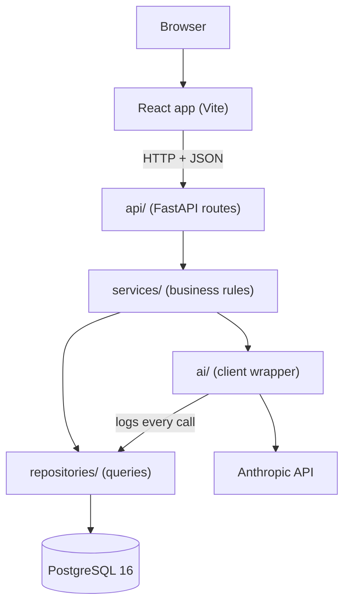
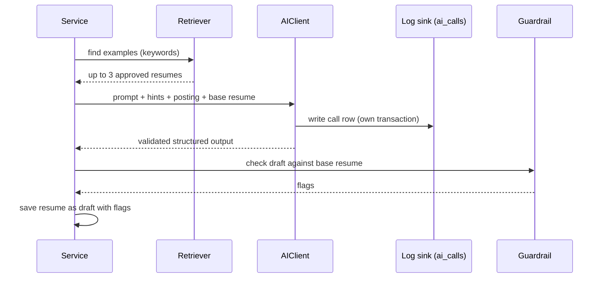

# Architecture

> Update this file whenever the structure changes so it always describes the code as built.

## System overview

Three tiers: 

- a React single-page app
- a FastAPI backend
- PostgreSQL

The backend is the only part that talks to the database or the LLM.

## Backend layers

Request flow: `api/ -> services/ -> repositories/ -> models/`.

| Layer | Responsibility | Must not |
| --- | --- | --- |
| `api/` | HTTP only: parse and validate input, call one service, return a schema | Query the database or hold business rules |
| `schemas/` | Pydantic models for requests and responses | Contain logic |
| `services/` | All business rules: transitions, guards, coverage, guardrail, review, metrics | Import FastAPI or write SQL |
| `repositories/` | All database queries | Make decisions |
| `models/` | SQLAlchemy table definitions | Contain logic |
| `ai/` | Anthropic client wrapper, prompt templates, output schemas | Be called except through the `AIClient` interface |
| `core/` | Config from environment variables, DB session, logging, middleware, the clock (`clock.py`, injected into services so tests control "now") | Know about the domain |

## Deterministic and non-deterministic parts

| Step | Kind | Module |
| --- | --- | --- |
| Stage transitions and guards | Deterministic | `services/transitions.py`, `services/applications.py` |
| Timeline history | Deterministic | `repositories/timeline.py` |
| Extract requirements and keywords | Non-deterministic (LLM) | `services/analysis.py` via `ai/` |
| Keyword coverage | Deterministic | `services/coverage.py` |
| Retrieve past examples | Deterministic | `services/retrieval.py` |
| Write a tailored resume | Non-deterministic (LLM) | `services/tailoring.py` via `ai/` |
| Render structured output to Markdown | Deterministic | `services/rendering.py` |
| Guardrail check | Deterministic | `services/guardrail.py` |
| Approve or reject | Human | `services/review.py` records the decision |
| Workflow step status | Deterministic | `services/workflow.py` |
| Stale rule | Deterministic | `services/staleness.py` |
| Metrics | Deterministic | `services/metrics.py` |

Only two steps call the LLM. Each is followed by deterministic checks and a human decision.

Each LLM step is split in two. A pure function in `services/generation.py` (`analyze()` and `tailor()`) calls the `AIClient` and returns validated output, and it touches no database. The service around it (`services/analysis.py`, `services/tailoring.py`) gathers the inputs, calls the pure function and saves the result. The eval calls the pure functions directly with an in-memory log sink.

## Trust chain for AI output

An LLM result passes through three layers before it is used:

1. **Schema.** Structured outputs constrain the response to a JSON schema, and Pydantic validates it. This guarantees shape, not truth.
2. **Guardrail.** Plain code compares the draft's employers, titles, dates, numbers, skills and posting keywords with the base resume and flags anything not found, matching whole tokens only. This checks facts that code can match exactly. The flags as generated are stored for metrics. The flags the user sees are recalculated from the current text, so editing updates them.
3. **Human.** Every analysis and resume is saved as `draft`. Only a user action sets `approved` or `rejected`.

Separately, the eval script measures how often a prompt version produces flags, so prompt changes are judged on numbers.

## State and guards

Application stage is a state machine defined as data.

- `services/transitions.py` holds the allowed transitions and a guard table keyed by action. An action is a stage transition (for example Saved → Applied) or another gated step (Start tailoring). A guard is a function `(context) -> None | GuardFailure`, where `context` carries the application, its related records and any extra input, such as the chosen resume.
- `ApplicationService.change_stage()` is the only code path that writes `applications.stage`. It validates the transition, runs the guards, updates the stage and inserts a timeline event in one transaction. The service takes a clock, so tests control "now". Two documented exceptions: creating an application (the column default is `saved`, and the service writes the initial event) and the seed script.
- Guards read the state of other entities. This is how separate lifecycles interlock:

| Action | Guard |
| --- | --- |
| Start tailoring | The application has an approved posting analysis |
| Saved → Applied | The request chooses a resume: the base resume, or an approved tailored resume for this application. Choosing the base resume saves a snapshot of it, and the snapshot becomes the submitted resume |

`POST /applications/{id}/apply` is the only endpoint that performs Saved → Applied. It calls `change_stage()` with the chosen resume in `context` and creates the snapshot in the same transaction. The generic stage endpoint rejects that transition with 409.

Analyses and resumes have their own small lifecycle: `draft → approved` or `draft → rejected`. A draft with a newer draft for the same application and feature is shown as `superseded` (derived, never stored and never auto-rejected).

The detail page shows three workflow steps: posting analysis, tailored resume, mark as applied. Their status (locked, available, current, done, skipped) is computed from the records by a pure function and returned by the API. It is never stored. Rules, checked in this order for each step, with "left Saved" meaning the stage is no longer Saved:

| Step | done | skipped | locked | current | otherwise |
| --- | --- | --- | --- | --- | --- |
| 1 Posting analysis | an approved analysis exists | left Saved without one | never | stage is Saved and none is approved | never |
| 2 Tailored resume | an approved tailored resume exists | left Saved without one | no approved analysis | an approved analysis exists and no approved tailored resume | never |
| 3 Mark as applied | left Saved with a submitted resume | left Saved without one (withdrawn) | no base resume exists | stage is Saved and an approved tailored resume exists | available |

At most one step is current. An application withdrawn from Saved shows no applied date and is never shown as applied.

## Data principles

- **Append-only logs.** `timeline_events` and `ai_calls` are never updated or deleted. The repositories expose no update or delete for them, and database triggers reject both. Triggers also reject any change to `resumes.draft_markdown`. `TRUNCATE` is not blocked, so `seed --reset` and test cleanup still work.
- **Current state is a projection.** `applications.stage` is the latest state; the timeline is the history. Both are written together in `change_stage()`.
- **Derived values are never stored.** Keyword coverage, AI outcome, edit ratio, guardrail flag count, current guardrail flags and every metric are calculated on request from stored rows. `guardrail_flags` itself is the stored snapshot of the flags as generated.
- **Original drafts are preserved.** `resumes.draft_markdown` never changes after generation, so the amount of user editing can be measured against `content_markdown`.
- **What was sent is preserved.** Marking an application as applied with the base resume stores an immutable snapshot of it. Editing the base resume later never changes the record of what was sent.
- **Snapshots are not tailored resumes.** A snapshot is a `resumes` row with `application_id` set and `ai_call_id` null. Repositories expose "tailored" and "snapshot" as named predicates, and retrieval and metrics use them.

## AI call path

- Prompts are versioned modules in `ai/prompts/`. Each exposes a `VERSION` and a `render()` function that returns a `RenderedPrompt` (`PromptModule` is the Protocol).
- Modules, as built:
  - `ai/types.py`: the `AIClient` and `LogSink` Protocols, `AICallRecord`, `AIResult`, and the errors (`AIAPIError`, `AIRefusalError`, `AITruncatedError`, `AIValidationError`, each carrying the `ai_call_id`; `AIConfigurationError` is separate because no call was made).
  - `ai/client.py`: `AnthropicAIClient.generate()`, the only code that calls Anthropic. It uses `messages.create` with a JSON schema from the Pydantic model, checks the stop reason, then validates the text itself. It never sets a temperature.
  - `ai/sinks.py`: `DatabaseLogSink` (own session and commit, through `repositories/ai_calls.py`) and `InMemoryLogSink`.
  - `ai/cost.py`: `estimate_cost()` over the `MODEL_PRICES` table in `core/config.py`.
  - `api/ai.py`: `get_ai_client()`, the FastAPI provider that tests override with `FakeAIClient` (`tests/fakes.py`).
  - `models/ai_call.py` and `repositories/ai_calls.py`: the table, and a repository with `add` and `get` only.
  - `scripts/ai_smoke.py`: a hand-run check of the real API against the test stub. It is not part of `make test`.
- The wrapper writes one row per call to a log sink, including failures (API error, refusal, truncated output, validation error). The app's sink writes `ai_calls` and commits in its own transaction, so the row survives a rollback in the caller. The eval passes an in-memory sink.
- `AIClient` returns the validated output and the `ai_call_id`, so artifacts can store the foreign key.
- The model name and API key come from environment variables and never reach the frontend.
- Tests inject a `FakeAIClient` that writes through the same log sink, so rows and foreign keys behave as in production. No test makes a network call. Because the log commits separately, tests clean up by truncating tables instead of rolling back.
- Starting an analysis or a tailoring takes a Postgres advisory lock per application and feature. A second request while one is running gets 409. The buttons are also disabled while a call is in flight.

## Retrieval

`services/retrieval.py` defines an `ExampleRetriever` interface. The MVP implementation uses PostgreSQL full-text search over `applications.posting_tsv`, queried with the approved analysis keywords joined by OR (multi-word keywords quoted) and ranked by `ts_rank`. A vector-search implementation can replace it without changing the tailoring service.

## Base resume

One editable Markdown document, stored as the `resumes` row with no application (`application_id` null). A unique partial index (`resumes_one_base_idx`) lets the database allow only one. `GET /resume` returns it or 404. `PUT /resume` creates or replaces it in place and always leaves it `approved`: `ResumeService.save_base()` sets the status and `updated_at` (from the injected clock), and the request schema carries only the text. A save that loses a race to a parallel first save replaces the row the other one created. Blank text is rejected. Replacing the text never changes what an application already sent, because applying with the base resume stores a snapshot (feature 11).

## Frontend

| Route | Page |
| --- | --- |
| `/` | Applications list, with stage counts, stage filter and the new application dialog |
| `/applications/:id` | Application detail: posting, analysis, tailored resume, mark as applied, timeline |
| `/resume` | Base resume editor |
| `/insights` | Metrics |

- Server state is fetched and cached with TanStack Query. There is no client-side store.
- The frontend holds NO business rules. Allowed next stages, guard failures and step status all come from the API. So do the options in the Change stage control (Applied is not one of them), which analysis and which tailored resume the page displays, and which resumes can be submitted, each with a reason when it cannot.
- Creating and editing an application share one dialog. Everything else on the detail page is a section that changes state in place; nothing navigates between steps.
- Components are shadcn/ui with Tailwind.
- `docs/screenshots/` shows the finished pages. `docs/reference/v0-prototype/` holds generated reference code that is never imported.

## Observability

- Middleware writes one structured JSON log line per request: request ID, method, path, status and latency.
- `timeline_events` and `ai_calls` are the product-level event logs. The Insights page reads them through `GET /metrics/pipeline` and `GET /metrics/ai`.

## Testing

| What | How |
| --- | --- |
| Pure logic (transitions, coverage, guardrail, rendering, edit ratio) | Unit tests |
| Services, repositories and API | Integration tests against a PostgreSQL test database |
| AI plumbing | Tests with `FakeAIClient` |
| Rules that must never be broken | An architecture test that only `change_stage()` (and the documented exceptions) writes `applications.stage`, and trigger tests that UPDATE and DELETE on the append-only tables fail |
| Prompt quality | The eval script, run by hand against the real model |
| UI | One smoke test, plus manual checks |

## Key decisions

| Decision | Reason |
| --- | --- |
| Transitions and guards as data | Rules are readable in one place and the engine is reusable for other workflows |
| Structured JSON for tailored resumes | The guardrail needs fields it can compare exactly; free Markdown cannot be checked reliably |
| Guardrail in plain code, not a second LLM call | A deterministic check can be unit tested and gives the same answer every time |
| Metrics calculated, not stored | Stored counters drift; queries over event logs always match the data |
| Call log commits separately | Failed calls must still be recorded |
| Call log goes through a sink | The eval can run the same code without writing to the app database |
| Base resume snapshot on apply | The base resume is editable, so "what I sent" must be frozen |
| Append-only enforced by triggers | A convention can be broken by one mistaken query; the database cannot |
| Flags stored as generated, current flags derived | Metrics compare prompt versions fairly, and the user sees flags that match the text |
| Full-text search before vector search | No extra service or API key, and it is enough for one user's history |
| No authentication | Single-user app |
