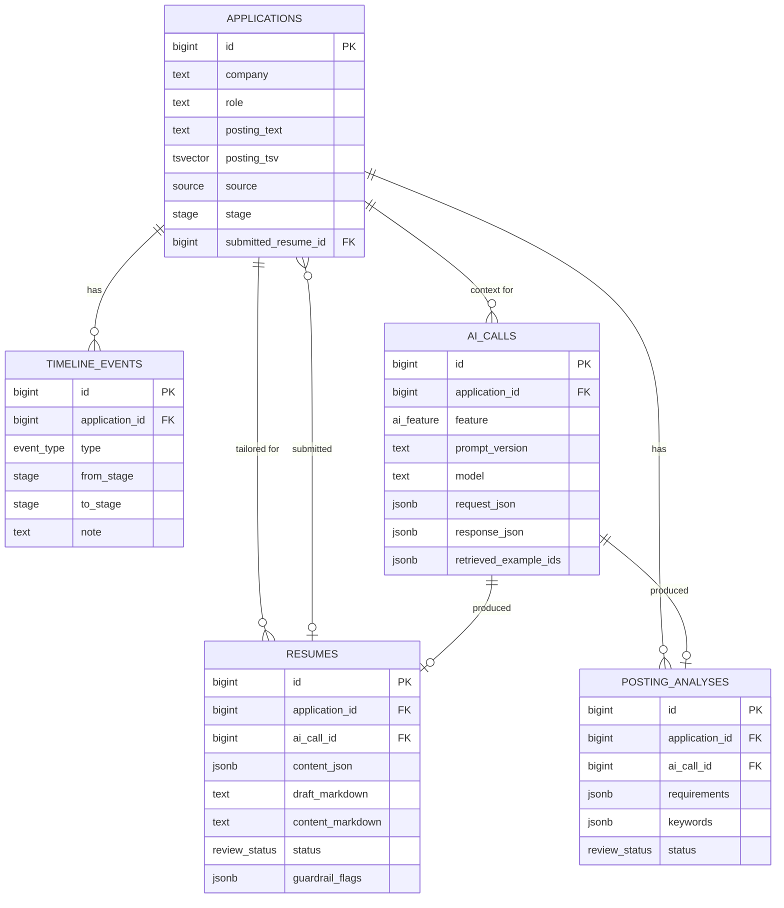
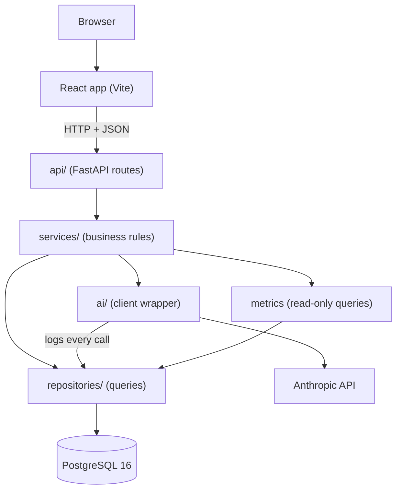

# Job Application Tracker - Project Overview

> **Track every application through the hiring pipeline, tailor your resume with AI you can verify, and measure how both the search and the AI are performing.**

---

## 📋 Table of Contents

- [Problem Statement](#-problem-statement)
- [Target User](#-target-user)
- [Design Principle](#-design-principle)
- [Features](#-features)
- [AI Design](#-ai-design)
- [Data Architecture](#️-data-architecture)
- [Tech Stack](#️-tech-stack)
- [Telemetry](#-telemetry)
- [UI/UX Guidelines](#-uiux-guidelines)
- [Suggested Project Structure](#-suggested-project-structure)
- [Working Agreements](#-working-agreements)
- [Out of Scope](#-out-of-scope)
- [Next Steps](#-next-steps)

---

## 🎯 Problem Statement

| Problem | What the app does |
| --- | --- |
| Applications are scattered across spreadsheets, email and memory | One list, one enforced pipeline, one timeline per application |
| Tailoring a resume to each posting is slow | AI drafts a tailored version from the base resume |
| AI drafts can invent experience | A deterministic guardrail flags invented facts, and a person approves every draft |
| No way to tell whether the search or the AI is working | Metrics are calculated from append-only event logs |

**The result:** a single-user web app that tracks applications, analyzes postings, tailors resumes, and reports on both the job search and the AI.

---

## 👥 Target User

| User | Needs |
| --- | --- |
| One job seeker (the owner) | Track applications, tailor resumes quickly, trust what the AI wrote, see what's working |

There is no authentication and no multi-user support. State this in the README.

---

## 🧭 Design Principle

The system is split explicitly into deterministic and non-deterministic logic. `docs/architecture.md` must label which parts are which.

| Step | Kind |
| --- | --- |
| Stages, transitions, guards, timeline | Deterministic (plain code) |
| Extract requirements and keywords from a posting | Non-deterministic (LLM) |
| Keyword coverage | Deterministic |
| Retrieve past examples | Deterministic |
| Write a tailored resume | Non-deterministic (LLM) |
| Guardrail check | Deterministic |
| Approve or reject | Human |
| All metrics | Deterministic |

Every non-deterministic step is followed by a deterministic check, and a person makes the final decision.

---

## ✨ Features

Features are listed in build order. Each one leaves the app in a working state.

### A. Applications

- Create, list, view and edit applications.
- Fields: company, role, posting URL (optional), posting text (pasted by hand), source.
- Source is one of: referral, LinkedIn, company site, recruiter, other.
- Creating and editing share one dialog: New application opens it from the list, and Edit opens it from the detail page. There is no separate "new application" page.
- The list shows a count per stage at the top, can be filtered by stage, and shows each application's last activity, a stale tag and which resume was sent.

### B. Stages and Timeline

Stages: Saved, Applied, Screening, Interviewing, Offer, Accepted, Rejected, Withdrawn.

| From | Allowed next stages |
| --- | --- |
| Saved | Applied, Withdrawn |
| Applied | Screening, Interviewing, Rejected, Withdrawn |
| Screening | Interviewing, Rejected, Withdrawn |
| Interviewing | Offer, Rejected, Withdrawn |
| Offer | Accepted, Rejected, Withdrawn |
| Accepted, Rejected, Withdrawn | Terminal |

- Transitions and guards are defined as data (a table in code), not as if-statements.
- Stage changes happen only through `ApplicationService.change_stage()`, which validates the transition, checks guards and writes a timeline event in the same transaction.
- Timeline events are append-only. Never update or delete them.
- Notes can be added to the timeline. Interview rounds are notes under Interviewing, not separate stages.

**Guards (conditions across entities):**

| Action | Requires |
| --- | --- |
| Saved → Applied | A submitted resume is chosen (base or an approved tailored resume) |
| Submit a tailored resume | That resume's status is `approved` |
| Start tailoring | The application has an `approved` posting analysis |

The detail page presents these as three steps: posting analysis, tailored resume, mark as applied. Step status is computed by the API from the data and never stored. An application withdrawn from Saved is never shown as applied: its steps show what was done and the rest as skipped.

Moving to Applied happens in a "Mark as applied" section on the detail page, where the user picks the resume they sent. The app records what the user reports. It does not submit applications.

Saved → Applied goes through a dedicated apply action, not the generic Change stage control. When the user picks the base resume, the app saves an immutable copy of it for this application, so later edits to the base resume cannot change the record of what was sent.

### C. Base Resume

- A single editable Markdown document.
- It is the only source of facts for tailoring. It should contain everything that can honestly be claimed; each tailored resume is a selection from it.

### D. Posting Analysis

- The LLM extracts structured requirements and keywords from the posting text.
- The result is saved as `draft`. The user approves or rejects it. There is no editing of the analysis in the MVP.
- Running the analysis again creates a new draft. Tailoring uses the latest approved analysis. Coverage uses the latest approved analysis, or the latest draft when none is approved, so the card can show coverage while the analysis is still in review.
- Code calculates keyword coverage against the base resume: which keywords are covered and which are missing. There is no "ATS score".

### E. Tailored Resume

1. Retrieve up to 3 past approved tailored resumes from applications with similar postings.
2. The LLM writes a structured draft from the base resume, the posting and the examples.
3. The guardrail check flags any fact not found in the base resume.
4. The user sees the base resume and the draft side by side, with flags and coverage before and after.
5. The user edits the draft, then approves or rejects it.
6. An approved resume is read-only and can be copied as Markdown.

The draft as generated is preserved so the amount of editing can be measured.

Every draft is kept, whatever its outcome. Rejected and unreviewed drafts feed the AI metrics and are never used as retrieval examples.

The LLM runs only when the user clicks Analyze or Tailor resume. Nothing else in the app calls it.

### F. Insights

- `GET /metrics/pipeline` and `GET /metrics/ai`.
- One page with a funnel chart and plain tables. See [Telemetry](#-telemetry).

### G. Seed Data and Eval

- A seed script fills a fresh database with about 40 realistic applications, timelines and AI call rows.
- An eval script measures prompt quality against fixed fixtures. See [AI Design](#-ai-design).

---

## 🤖 AI Design

### Call Shape

```
Result = LLM(Prompt, Hints + JD + Resume)
```

| Part | What it is |
| --- | --- |
| Prompt | A versioned template stored in code (`ai/prompts/`) |
| Hints | Rules (never invent experience) plus retrieved examples |
| JD + Resume | The posting text and the base resume |
| Result | JSON matching a schema, validated with Pydantic, saved as `draft` |

### Rules

- Use Claude's structured outputs (`output_config.format` with a JSON schema) for every call. The Python SDK's `messages.parse()` accepts a Pydantic model directly.
- Check the stop reason before parsing. A refusal or a response cut off at the token limit is logged as a failed call.
- All calls go through one wrapper in `ai/`. The wrapper writes one row per call to a log sink, whether the call succeeded or failed. The app's sink writes `ai_calls`. The eval passes an in-memory sink, so it never writes to the app database.
- Limits such as the 25-keyword cap, lowercase and deduplication are enforced in code after parsing, not in the JSON schema, because structured outputs support only part of JSON Schema (confirm against the current docs in feature 5). Over-long lists are trimmed, not treated as failures.
- `tailor_resume` v1 includes the examples section from the start, empty until retrieval (feature 12) fills it. Filling it changes data, not the template, so it is not a new version. v2 is the next prompt change and comes from eval results.
- Services call the wrapper through an interface so tests can mock it. Tests mock all AI calls.
- Tailoring may only rephrase, reorder and emphasize facts from the base resume. It must never invent experience, skills, employers, titles, dates or metrics.
- Retrieved examples show style and emphasis only. The base resume is the only source of facts. The prompt must say so.
- The posting text is untrusted input. Wrap it in delimiters and instruct the model to treat it as data.
- Never set temperature. Reproducibility comes from storing inputs and outputs, not from regenerating.
- `ANTHROPIC_API_KEY` and `ANTHROPIC_MODEL` come from environment variables. Never send them to the frontend or commit them.

### Tailored Resume Output Schema

```python
class Experience(BaseModel):
    employer: str
    title: str
    dates: str
    bullets: list[str]

class TailoredResume(BaseModel):
    summary: str
    experiences: list[Experience]
    skills: list[str]
```

Markdown is rendered from this structure by plain code. Sections of the base resume other than summary, experience and skills (header and contact details, education, projects, certifications) are copied through unchanged, so the tailored resume is complete and the model never touches them.

### Guardrail Check (Deterministic)

After tailoring, code compares the structured draft with the base resume text.

Matching rule: normalize both sides (lowercase, collapse whitespace, en and em dashes become hyphens), then match whole tokens or phrases on word boundaries. Never match raw substrings: "Go" must not match "Google" and "5" must not match "2025".

| Draft field | Flagged when |
| --- | --- |
| Employer | Not found in the base resume |
| Title | Not found in the base resume |
| Dates | A year or month in the value is not in the base resume (years as whole tokens, months compared by their first three letters; "Present" and "Current" are ignored) |
| Numbers in summary and bullets | A number token is not in the base resume (a token is digits with optional `,` `.` `$` `%` and a trailing `k`, `m` or `x`) |
| Skills | Not found in the base resume |
| Posting keywords | An approved analysis keyword appears in the draft (summary, bullets or skills) but not in the base resume |

- The flags as generated are stored on the resume and never change. Metrics read them, so prompt versions are compared fairly.
- The flags shown beside the draft are the current flags, calculated on request. A structural flag (employer, title, dates, skill) drops out once its value is no longer in the text. Number and keyword flags are recalculated from the current text. Editing therefore updates the box, and no check is skipped for text the user added.
- Flags do not block approval and are not auto-fixed. The user decides.

> **Note:** A flag is about the draft, not the posting. A keyword the posting wants and the resume lacks is a *missing keyword* in coverage, not a flag.

### Retrieval (RAG)

- Build a search query from the approved analysis keywords, joined with OR. Multi-word keywords are quoted so they stay phrases.
- Search `applications.posting_tsv` with Postgres full-text search and rank with `ts_rank`.
- Take up to 3 matches that have an approved tailored resume. Include those resumes as examples.
- Log the example ids on the call (`ai_calls.retrieved_example_ids`).
- With no approved resumes yet, tailoring runs without examples.
- Put retrieval behind an interface so it can later be swapped for vector search.

**Later improvements (not built; out of scope for the MVP).** Full-text search matches words, not meaning: "Backend engineer, Rails" and "Ruby on Rails developer" share few tokens, and boilerplate in a posting counts toward the match. Two upgrades, in order, each a new `ExampleRetriever` implementation that leaves the tailoring service unchanged:

1. **Embedding search (pgvector).** Embed each posting once, when it is saved or edited, and store the vector in the same database with an HNSW index. At query time embed the current posting (or its approved requirements and keywords, so boilerplate does not count) and take the nearest neighbours by cosine distance. This finds the same kind of role when the wording differs. It needs an embeddings model and key (Anthropic offers none), a backfill step and a new dependency, so it needs approval first.
2. **Hybrid search.** Run the full-text and the vector search, then merge the two rankings with reciprocal rank fusion. Exact terms such as "Kubernetes" still count, and the vector side covers paraphrases. This is the usual best practice for production RAG.

Upgrade only if the eval (feature 16) shows that examples improve drafts and that better matches improve them further. Reranking with an LLM is not suggested: it would add a third place that calls the model.

### Eval

A script (`python -m evals.run`) that calls the real model. It is run by hand when a prompt or the model changes. It does not run in CI.

- 3–5 fixtures, each a posting and a base resume.
- One trap fixture: the posting demands a skill the resume does not have.

| Pass condition per fixture |
| --- |
| Zero guardrail flags on employer, title, dates and numbers |
| None of the fixture's forbidden skills appear in the draft |
| Keyword coverage of the draft is higher than the base resume's (equal is enough when the base is already at 100%) |

Results are written to a file tagged with prompt version and model, and committed.

---

## 🗄️ Data Architecture

### Entity Relationship Diagram



### Schema

This is the final shape. Implement it as SQLAlchemy 2.0 models with Alembic migrations. Each feature's migration creates only the tables and columns that feature uses, so the schema is built up in the order of the feature specs.

```sql
CREATE TYPE stage AS ENUM (
  'saved', 'applied', 'screening', 'interviewing',
  'offer', 'accepted', 'rejected', 'withdrawn'
);
CREATE TYPE source AS ENUM ('referral', 'linkedin', 'company_site', 'recruiter', 'other');
CREATE TYPE review_status AS ENUM ('draft', 'approved', 'rejected');
CREATE TYPE event_type AS ENUM ('stage_change', 'note');
CREATE TYPE ai_feature AS ENUM ('posting_analysis', 'tailor_resume');

CREATE TABLE applications (
  id                  BIGSERIAL PRIMARY KEY,
  company             TEXT NOT NULL,
  role                TEXT NOT NULL,
  posting_url         TEXT,
  posting_text        TEXT NOT NULL,
  posting_tsv         TSVECTOR GENERATED ALWAYS AS
                        (to_tsvector('english', posting_text)) STORED,
  source              source NOT NULL,
  stage               stage NOT NULL DEFAULT 'saved',   -- written only by change_stage()
  submitted_resume_id BIGINT,                           -- FK added below; a tailored resume or a base-resume snapshot
  created_at          TIMESTAMPTZ NOT NULL DEFAULT now(),
  updated_at          TIMESTAMPTZ NOT NULL DEFAULT now()
);
CREATE INDEX applications_posting_tsv_idx ON applications USING GIN (posting_tsv);

-- Append-only
CREATE TABLE timeline_events (
  id             BIGSERIAL PRIMARY KEY,
  application_id BIGINT NOT NULL REFERENCES applications(id),
  type           event_type NOT NULL,
  from_stage     stage,
  to_stage       stage,
  note           TEXT,
  created_at     TIMESTAMPTZ NOT NULL DEFAULT now()
);

-- Append-only
CREATE TABLE ai_calls (
  id                    BIGSERIAL PRIMARY KEY,
  application_id        BIGINT REFERENCES applications(id),
  feature               ai_feature NOT NULL,
  prompt_version        TEXT NOT NULL,
  model                 TEXT NOT NULL,
  request_json          JSONB NOT NULL,   -- the full rendered prompt
  response_json         JSONB,            -- null when the call failed
  retrieved_example_ids JSONB NOT NULL DEFAULT '[]',
  input_tokens          INTEGER,
  output_tokens         INTEGER,
  estimated_cost        NUMERIC(10, 6),   -- stored at call time; prices change
  latency_ms            INTEGER NOT NULL,
  schema_valid          BOOLEAN NOT NULL,
  stop_reason           TEXT,
  error                 TEXT,
  created_at            TIMESTAMPTZ NOT NULL DEFAULT now()
);

CREATE TABLE resumes (
  id               BIGSERIAL PRIMARY KEY,
  application_id   BIGINT REFERENCES applications(id),  -- null only for the base resume
  ai_call_id       BIGINT REFERENCES ai_calls(id),      -- null for the base resume and its snapshots
  content_json     JSONB,                               -- structured model output
  draft_markdown   TEXT,                                -- as generated, never changed
  content_markdown TEXT NOT NULL,                       -- current text, with edits
  status           review_status NOT NULL DEFAULT 'draft',
  guardrail_flags  JSONB NOT NULL DEFAULT '[]',
  created_at       TIMESTAMPTZ NOT NULL DEFAULT now(),
  updated_at       TIMESTAMPTZ NOT NULL DEFAULT now(),
  reviewed_at      TIMESTAMPTZ
);
-- Only one base resume
CREATE UNIQUE INDEX resumes_one_base_idx ON resumes ((true)) WHERE application_id IS NULL;
-- A base-resume snapshot is a row with application_id set, ai_call_id null and status 'approved'.
-- Repositories expose "tailored" and "snapshot" as named predicates so retrieval and metrics
-- never mistake one for the other.

ALTER TABLE applications
  ADD CONSTRAINT applications_submitted_resume_fk
  FOREIGN KEY (submitted_resume_id) REFERENCES resumes(id);

CREATE TABLE posting_analyses (
  id             BIGSERIAL PRIMARY KEY,
  application_id BIGINT NOT NULL REFERENCES applications(id),
  ai_call_id     BIGINT NOT NULL REFERENCES ai_calls(id),
  requirements   JSONB NOT NULL,
  keywords       JSONB NOT NULL,
  status         review_status NOT NULL DEFAULT 'draft',
  created_at     TIMESTAMPTZ NOT NULL DEFAULT now(),
  reviewed_at    TIMESTAMPTZ
);

-- Indexes on the per-application foreign keys (each feature's migration adds the ones for its own table)
CREATE INDEX timeline_events_application_idx ON timeline_events (application_id, created_at);
CREATE INDEX ai_calls_application_idx ON ai_calls (application_id);
CREATE INDEX resumes_application_idx ON resumes (application_id);
CREATE INDEX posting_analyses_application_idx ON posting_analyses (application_id);

-- Append-only is enforced by the database, not only by convention.
-- Triggers raise an error on UPDATE or DELETE of timeline_events and ai_calls, and on any
-- change to resumes.draft_markdown after insert. TRUNCATE is not blocked, so `seed --reset`
-- and test cleanup still work.
```

### Derived Values (Never Stored)

| Value | Derived from |
| --- | --- |
| Keyword coverage | Analysis keywords and resume text, on request |
| AI outcome (approved, edited then approved, rejected, pending, superseded) | Artifact `status`, and whether `content_markdown` differs from `draft_markdown`. A draft that is still `draft` but has a newer draft for the same application and feature is `superseded`, not `pending`. A superseded draft is never auto-rejected: only a user action sets a status. |
| Edit ratio | `draft_markdown` vs `content_markdown`: 1 − `SequenceMatcher(autojunk=False).ratio()`, so 0 means unedited |
| Guardrail flag count | Length of `guardrail_flags`, the flags as generated |
| Current guardrail flags | `guardrail_flags`, `content_markdown` and the base resume, on request (see Guardrail Check) |
| All metrics | Queries over `timeline_events` and `ai_calls` |

### Seed Data

`python -m scripts.seed` uses a fixed random seed and creates:

- 1 base resume (`application_id` null, status `approved`). Base-resume snapshots for applications submitted with the base resume are separate rows and are not counted here
- about 40 applications across all sources and stages
- timeline events spread over roughly 10 weeks
- posting analyses, tailored resumes and `ai_calls` rows for about half of them

Seeded AI rows use a model name of `seed` so they can be told apart from real calls.

The seed script writes through repositories with explicit timestamps. This is the one documented exception to the `change_stage()` rule, and the data must still pass every transition rule.

---

## 🛠️ Tech Stack

### Architecture Diagram



### Technology Choices

| Category | Technology | Notes |
| --- | --- | --- |
| Backend | Python 3.12, FastAPI | Managed with uv |
| ORM and migrations | SQLAlchemy 2.0, Alembic | Never edit an applied migration |
| Validation | Pydantic v2 | Request, response and AI output schemas |
| Backend tests and lint | pytest, ruff | |
| Frontend | React + TypeScript (Vite) | |
| Data fetching and routing | TanStack Query, React Router | |
| UI | Tailwind, shadcn/ui | Funnel chart via its Recharts-based chart components |
| Frontend tests | Vitest | One smoke test in the MVP |
| Database | PostgreSQL 16 | Installed locally; full-text search for retrieval |
| AI | Anthropic API, official Python SDK | Backend only |
| Local dev | Makefile, Procfile, honcho | `make setup`, `make dev` (runs the Procfile with honcho, a backend dev dependency); `api` and `web` processes; no Docker |
| CI | GitHub Actions | Backend lint and tests; frontend lint and build |

### Approved Packages

These need no extra approval. Ask before adding anything else.

| Area | Packages |
| --- | --- |
| Backend runtime | fastapi, uvicorn, sqlalchemy (sync), alembic, psycopg 3, pydantic, pydantic-settings, anthropic |
| Backend dev | pytest, httpx (FastAPI test client), ruff, honcho |
| Frontend runtime | react, react-dom, react-router, @tanstack/react-query, tailwindcss, shadcn/ui and its dependencies (Radix UI, class-variance-authority, clsx, tailwind-merge or `cn` (shadcn's drop-in replacement for both), lucide-react, sonner for toasts), the `shadcn` CLI package, @fontsource-variable/geist (shadcn's default font), @tailwindcss/vite (Tailwind's Vite plugin), recharts via the shadcn chart component |
| Frontend dev | vite, @vitejs/plugin-react, typescript, vitest, jsdom, @testing-library/react and its peer @testing-library/dom, eslint with @eslint/js and its TypeScript and React plugins, @types/* for the packages above |

### Backend Layering

Request flow: `api/ -> services/ -> repositories/ -> models/`

| Layer | Responsibility | Must not |
| --- | --- | --- |
| `api/` | HTTP only: validate input with `schemas/`, call a service, return a schema | Access the database |
| `services/` | All business rules | Import FastAPI |
| `repositories/` | All queries | Contain business logic |
| `ai/` | Anthropic client wrapper, prompt templates, output schemas | Be called except through its interface |
| `core/` | Config from environment variables, DB session, logging, middleware | |

Dependencies point inward only.

### Important Development Notes

> ⚠️ **Local setup uses a Makefile, a Procfile and a local PostgreSQL, not Docker.**
>
> ```bash
> make setup    # create the dev and test databases, run migrations, install dependencies
> make dev      # start the api and web processes from the Procfile
> make test     # backend and frontend tests
> make lint     # backend and frontend lint
> make seed     # fill the database with sample data
> make eval     # run the prompt eval against the real model
> ```
>
> ```
> # Procfile
> api: cd backend && uv run uvicorn app.main:app --reload --port 8000
> web: cd frontend && npm run dev
> ```

- Provide `.env.example` with `DATABASE_URL`, `TEST_DATABASE_URL`, `ANTHROPIC_API_KEY` and `ANTHROPIC_MODEL`.
- The Vite dev server proxies `/api/*` to port 8000 and strips the `/api` prefix, so backend routes have no prefix.
- Tests truncate tables between runs instead of rolling back, because the AI call log commits in its own transaction.
- The README lists prerequisites: Python 3.12, uv, Node, PostgreSQL 16.

### Recommended Links

- [FastAPI](https://fastapi.tiangolo.com/)
- [SQLAlchemy 2.0](https://docs.sqlalchemy.org/en/20/)
- [Alembic](https://alembic.sqlalchemy.org/)
- [Pydantic](https://docs.pydantic.dev/)
- [PostgreSQL full-text search](https://www.postgresql.org/docs/16/textsearch.html)
- [Claude structured outputs](https://platform.claude.com/docs/en/build-with-claude/structured-outputs)
- [TanStack Query](https://tanstack.com/query/latest)
- [shadcn/ui](https://ui.shadcn.com/)

---

## 📊 Telemetry

**Principle:** record events, calculate metrics from them. Metrics are queries over append-only data, never stored numbers that can drift.

### Process Telemetry (from `timeline_events`)

- Funnel conversion: Applied → Screening → Interviewing → Offer. Reaching a later stage counts as having passed the earlier funnel stages, so an application that goes straight from Applied to Interviewing still counts at Screening.
- Median time in each stage, from completed intervals only. A stage an application is still in, and the terminal stages, are not included.
- Response rate, and count of stale applications (no activity in 14+ days)
- Response rate for tailored vs base resume, with the sample size shown next to it

### AI Telemetry (from `ai_calls` and the artifacts they produced)

- Calls by feature, prompt version and model, so seeded rows (model `seed`) never blend with real calls
- Approval, edit and rejection rate by prompt version
- Edit ratio before approval
- Input and output tokens, estimated cost per call
- Median latency
- Failed calls and guardrail flags by prompt version

### System Telemetry

- FastAPI middleware writes one structured JSON log line per request: request ID, method, path, status code, latency.
- No Prometheus, Grafana or Datadog. The README notes how the event log and structured logs would plug into those tools.

---

## 🎨 UI/UX Guidelines

### Design Principles

- Plain and functional. Use shadcn/ui defaults; no custom design work.
- AI output is always labeled as a draft until approved.
- Flags and missing keywords are shown next to the content they refer to.
- Every number on the Insights page shows its sample size where it matters.
- Sections on the detail page change state in place. Nothing navigates between steps.
- The frontend holds no business rules. Allowed stages, guard results and step status come from the API. So do the stage-change options (Applied is not offered in the Change stage control), which analysis and which tailored resume to display, and which resumes can be submitted, with the reason when one cannot.

### Pages

| Route | Page |
| --- | --- |
| `/` | Applications list with stage counts, stage filter and the new application dialog |
| `/applications/:id` | Detail: step strip, posting, analysis, tailored resume, mark as applied, timeline |
| `/resume` | Base resume editor |
| `/insights` | Stat tiles, funnel chart and metrics tables |

Four pages and one dialog. There are no other routes.

### Application Detail Layout

One page, top to bottom:

1. Header: company, role, source, stage badge, Change stage control, Edit button
2. Step strip: posting analysis, tailored resume, mark as applied
3. Job posting and Posting analysis, side by side
4. Tailored resume
5. Mark as applied
6. Timeline

### Screenshots

| File in `docs/screenshots/` | Shows |
| --- | --- |
| `applications-list.png` | The list with stage filter, stale notice and table |
| `new-application-dialog.png` | The create and edit dialog |
| `base-resume.png` | The base resume editor |
| `detail-step-1.png` | Detail page with the analysis in review and tailoring locked |
| `detail-step-2.png` | Detail page with a tailored draft in review, including guardrail flags |
| `detail-step-3.png` | Detail page with the resume approved, ready to mark as applied |
| `insights.png` | The Insights page |

- Screenshots show finished pages with sample data. Build only what the current feature spec lists.
- Where a spec and a screenshot disagree, the spec wins.

### UI Reference Code

`docs/reference/v0-prototype/` holds generated component code for the same screens.

- Use it for layout, spacing and component choices.
- Do not copy its mock data, Next.js imports, `"use client"` directives or routing.
- Never import from it. Application code lives in `frontend/src/`.

---

## 📁 Suggested Project Structure

```
job-tracker/
├── CLAUDE.md
├── Makefile
├── Procfile
├── README.md
├── .env.example
├── docs/
│   ├── project-overview.md
│   ├── architecture.md
│   ├── AI_WORKFLOW.md
│   ├── features/
│   │   ├── current.md
│   │   └── 01-scaffold-spec.md ... 17-readme-workflow-spec.md
│   ├── screenshots/
│   └── reference/
│       └── v0-prototype/
├── backend/
│   ├── pyproject.toml
│   ├── alembic/
│   ├── app/
│   │   ├── main.py
│   │   ├── api/
│   │   ├── schemas/
│   │   ├── services/
│   │   ├── repositories/
│   │   ├── models/
│   │   ├── ai/
│   │   │   ├── client.py
│   │   │   ├── prompts/
│   │   │   └── schemas.py
│   │   └── core/
│   ├── evals/
│   │   ├── run.py
│   │   ├── fixtures/
│   │   └── results/
│   ├── scripts/
│   │   └── seed.py
│   └── tests/
├── frontend/
│   ├── package.json
│   └── src/
│       ├── pages/
│       ├── components/
│       ├── api/
│       └── main.tsx
└── .github/
    └── workflows/
        └── ci.yml
```

---

## 🤝 Working Agreements

### How to Start (Instructions for Claude Code)

Start in **plan mode**. Do not write application code yet.

1. Read this overview, `docs/architecture.md` and `CLAUDE.md`, and ask any clarifying questions.
2. Point out anything in them that is unclear or inconsistent, or that you would do differently, and propose changes.
3. Then work through the specs in `docs/features/` in order, one per session, starting with `01-scaffold-spec.md`.

Wait for approval of each plan before writing code.

### Rules

- Ask before adding a dependency not listed in this document.
- Never edit an applied migration; create a new one.
- Each migration creates only the tables and columns its feature uses.
- Commit plans, specs and decisions to the repo as you go, so the process is visible in the history.
- Small, focused commits with clear messages.
- When unsure about a requirement, ask instead of guessing.

### Definition of Done (Every Feature)

1. Plan first, and wait for approval before writing code.
2. Tests added or updated; all tests and lint pass.
   For frontend features, also verify the feature in a real browser with the Playwright MCP: walk the user flow, compare with the named screenshot and check the console for errors.
3. New endpoints appear correctly in `/docs` (OpenAPI).
4. `docs/features/current.md` updated with status and decisions.
5. A few lines added to `docs/AI_WORKFLOW.md`: what went wrong, what changed.

---

## 🚫 Out of Scope

- Authentication or multiple users
- Scraping postings from URLs (paste the text)
- Uploading or parsing resume PDFs (Markdown only)
- Email or calendar integration
- Payments
- Docker and deployment
- External observability stacks (Prometheus, Grafana, Datadog)
- Vector search, resume export, interview prep
- Deleting applications, and undoing a terminal stage. A mistake is corrected by a note.
- Re-running an analysis automatically when the posting text is edited. Editing the posting does not invalidate an analysis; run it again by hand.

---

## 🚀 Next Steps

**Day 1: skeleton and tracking**

- [ ] 01 Scaffold: Makefile, Procfile, local Postgres, FastAPI health check, Alembic, React shell, CI, request-logging middleware
- [ ] 02 Applications: list, detail page, and one dialog for create and edit, with source
- [ ] 03 Stages and timeline: transitions as data, `change_stage()`, append-only events, notes, stage counts and filter, last activity and stale tags

**Day 2: first AI call**

- [ ] 04 Base resume: one editable Markdown document
- [ ] 05 AI foundation: client wrapper, structured outputs, `ai_calls` logging, stop-reason handling, mockable interface
- [ ] 06 Posting analysis: extract requirements and keywords, save as draft, approve or reject
- [ ] 07 Keyword coverage against the base resume

**Day 3: tailoring**

- [ ] 08 Tailored draft: prompt v1, structured output rendered to Markdown, requires an approved analysis
- [ ] 09 Guardrail check with unit tests for each flag type
- [ ] 10 Review flow: side by side, edit, approve or reject, coverage before and after
- [ ] 11 Mark as applied: a section where the user picks the resume sent, plus the three-step strip
- [ ] 12 Retrieval: full-text search, up to 3 approved examples, logged on the call

**Day 4: measurement and write-up**

- [ ] 13 Seed script
- [ ] 14 Metrics endpoints: `/metrics/pipeline` and `/metrics/ai`
- [ ] 15 Insights page: funnel chart and tables
- [ ] 16 Eval script: fixtures including the trap; committed results for prompt v1 and v2
- [ ] 17 README and `docs/AI_WORKFLOW.md`; demo rehearsal from a clean checkout

If the schedule slips, drop in this order: time-in-stage table, retrieval (12), funnel chart. Do not drop the guardrail, the call log or the eval.

---

_Last updated: November 2026_
